# Kotodama 言霊 — JLPT Progress & Rank Tracker for Anki

**See how much Japanese your Anki deck really covers.**

Kotodama reads the deck you already have and shows your progress through every JLPT level, N5 to N1, in **vocabulary, kanji and grammar**. It also finds the grammar in your cards' example sentences, so mined sentence cards count too. You don't need a separate grammar deck.

Free, works offline, nothing to install besides the add-on. Version 3.0.0.

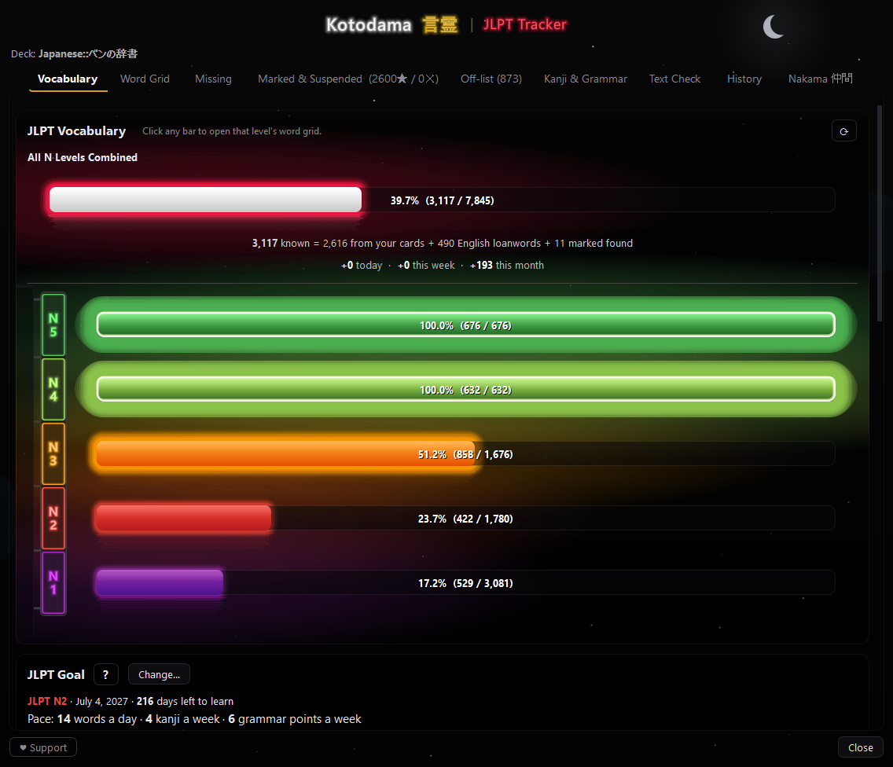

---

## What it does

### JLPT vocabulary, N5 → N1
One glowing bar per level, about 7,850 words in all, plus an All Levels bar and your gains today, this week and this month. Click a bar to open that level's **word grid**: every word as a tile, known words lit in the level's colour (brighter as the card matures), missing words dark. Hover a tile for its meaning, click a missing word to copy it, Shift+click to look it up on Jisho.

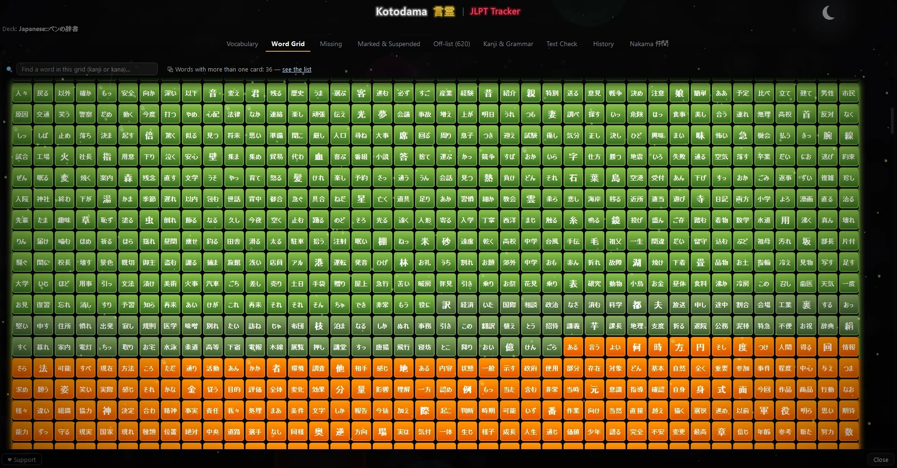

### Kanji and grammar, from your own cards
- **Kanji:** all 2,383 JLPT kanji, coloured by how well you know each one (from your cards' FSRS strength), weakest to strongest.
- **Grammar:** a built-in parser reads your cards' example sentences and finds the JLPT grammar points in them (526 points), conjugated forms included: ことにする also finds ことにした. Anything it misses can be marked found in one click.

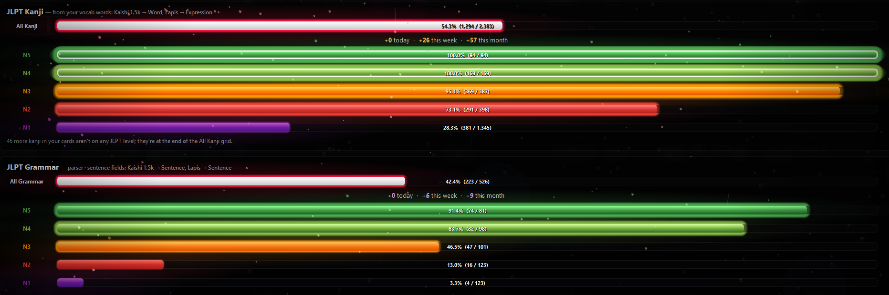

Click a bar to open its grid. Tiles are coloured from weak (red) to strong (teal), and points that are in your cards but not studied yet get a dashed outline.

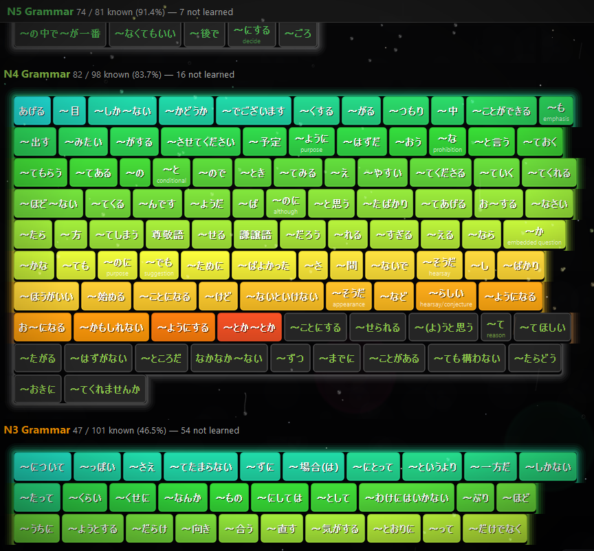
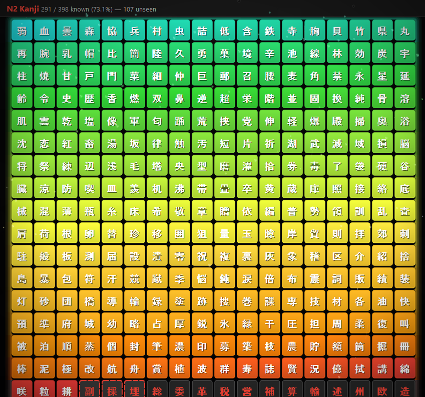

### Kotodama Japanese Rank
Every card you've studied counts toward 20,000 words, the vocabulary size associated with native-like fluency. Climb through ten ranks, from Gaijin (外人) up, each split into eight karate-style belts. The top rank stays secret until you reach it. A small message pops up during review when you earn a new belt.

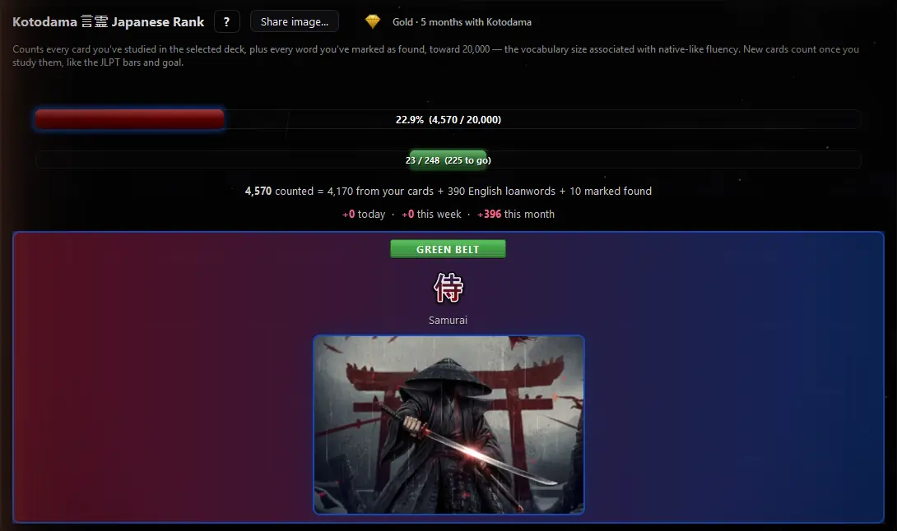

All the ranks

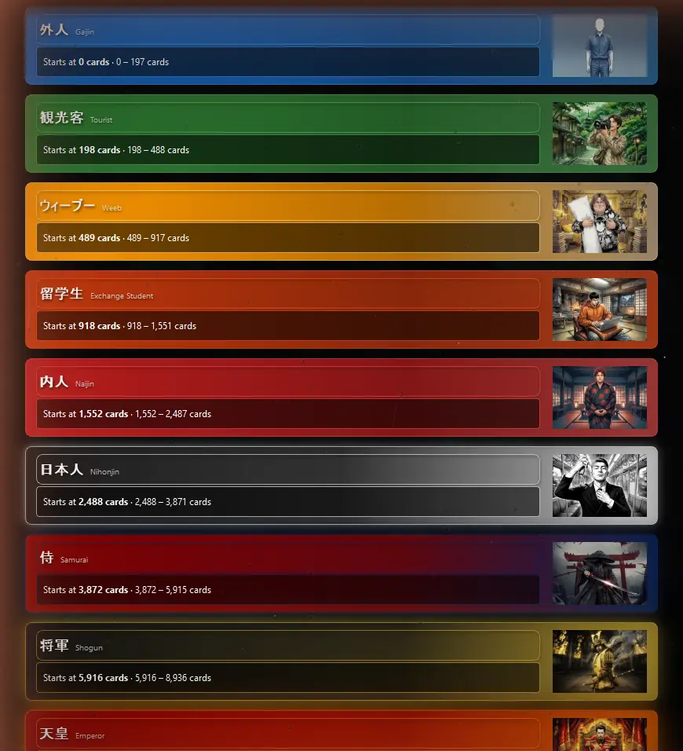

### Frequency Check
Are your cards the words that matter? Kotodama compares your deck with the 20,000 most common words of written Japanese (BCCWJ corpus). It shows roughly what share of everyday written text and everyday speech you can follow, and lists the most common words you're still missing.

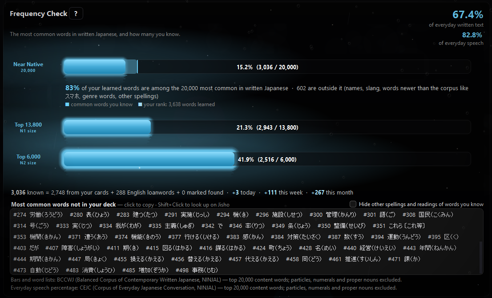

### JLPT Goal
Pick your level and test date. Kotodama works out how many words, kanji and grammar points to learn each day or week to be ready two weeks before the test. It's worked out fresh every day: no streaks, nothing lost for a missed day.

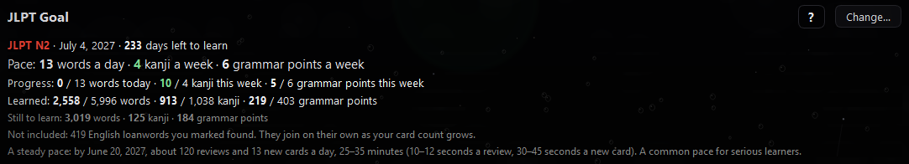

### Text Check
Paste any Japanese text (an article, a chapter, subtitles) or open a .txt / .srt / .vtt / .ass file. Kotodama shows what share of its words you already know, with a verdict from "comfortable" to "hard", the kanji and grammar points it uses, and the unknown words worth learning first.

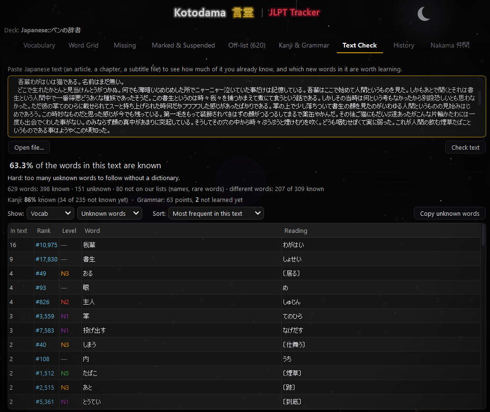

### History
A chart of your progress over time, rebuilt from your review history back to your first card, with your best week and an **On track** line toward your goal.

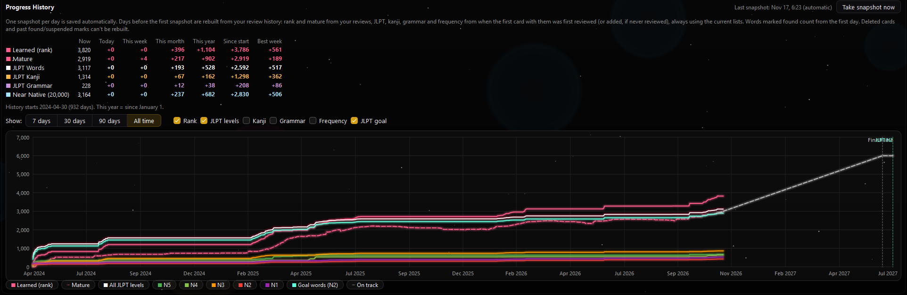

### Off-list words
Cards in your deck that aren't on the JLPT lists, most common first. They still count toward your rank and the Frequency Check.

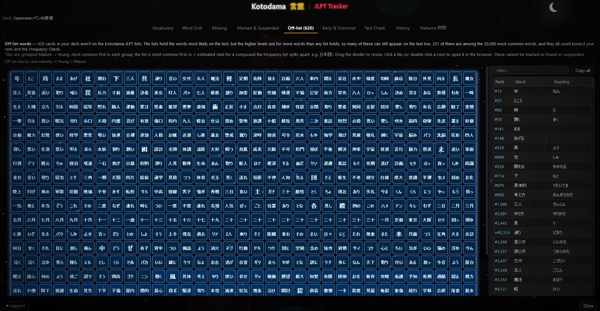

### Nakama 仲間 (friends)
Swap friend codes and see your friends' rank and bars next to yours, updated when they sync. Friends only: no search and no public list. Joining is optional.

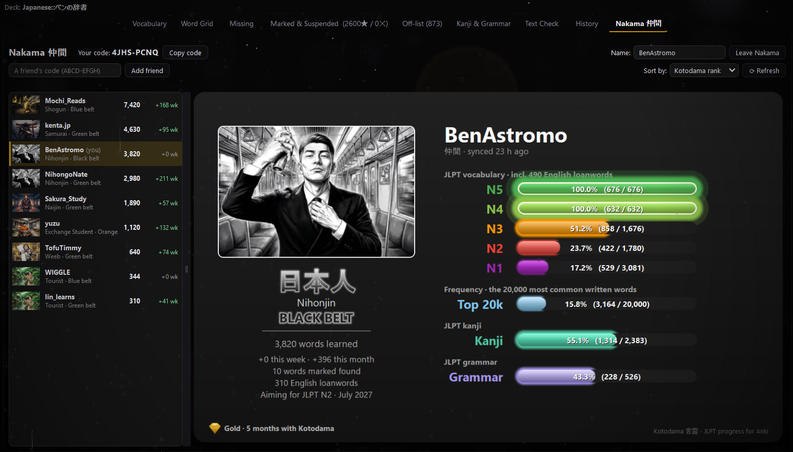

### On Anki's main screen
A small widget next to your deck list shows your N5–N1 bars, today's goal and your rank. Click it to open Kotodama. Next to your rank, **Share image…** makes a picture of your rank and bars to post.

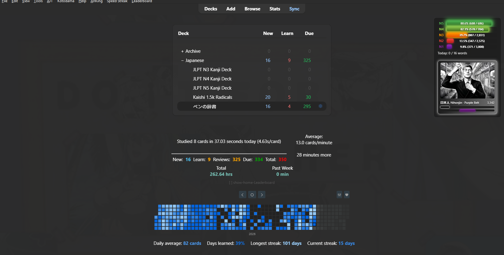

---

## Install

**From AnkiWeb (recommended):** in Anki, go to **Tools → Add-ons → Get Add-ons…**, paste the code **`1830630516`**, then restart Anki.

**By hand:** copy the `jlpt_progress` folder into your Anki add-ons folder, then restart Anki:
- **Windows:** `%APPDATA%\Anki2\addons21\`
- **macOS:** `~/Library/Application Support/Anki2/addons21/`
- **Linux:** `~/.local/share/Anki2/addons21/`

Requires Anki 2.1.50 or newer, desktop only (AnkiDroid and AnkiMobile don't support add-ons). On the older Qt5 builds (2.1.50–2.1.66) everything works except the top rank's animated picture and its ambience.

## Setup (one minute)

Open **Kotodama → Settings…** on Anki's menu bar (or click the **Click to set up** card on the main screen, or Tools → Add-ons → Kotodama → Config):

1. Pick your Japanese deck (sub-decks are included).
2. For each note type, pick the field with the Japanese word from the list (e.g. `Expression`). Optionally add a reading field and an example-sentence field. The sentence field is what the grammar parser reads.
3. Press OK. Open Kotodama from the menu or by clicking the widget on the main screen.

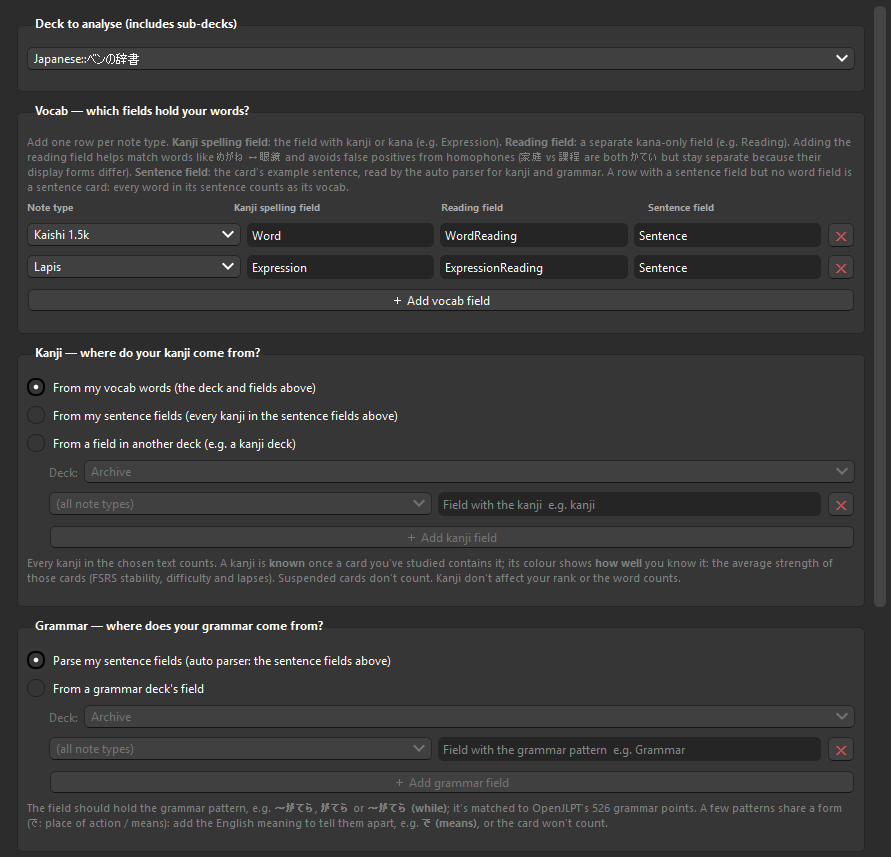

Only have sentence cards? Leave the word field empty and set the sentence field: every word in the sentence counts.

**What counts as "known":** a word counts once you've studied its card. Kotodama measures recognition, the words you'd understand while reading or listening. English loanwords you'd understand on sight (カメラ, テーブル) can be marked known in one click, so you don't need cards for them.

The **[full guide](docs/GUIDE.md)** explains every tab, setting and click in detail.

## Privacy

Kotodama works offline. It connects to the internet only if you join **Nakama**. Then your chosen name and the numbers on your card (rank, bars, words marked found, time with Kotodama and, if you choose, your JLPT goal) are sent to Kotodama's small server after Anki syncs, and your friends' cards are fetched when you open the tab. No cards, words, sentences or deck names are ever sent. Only people you give your friend code to can see your card. Leaving Nakama removes your name and numbers from the server. Your friend code and friends list are also saved in your Anki collection, so they follow your AnkiWeb sync. Everything else stays on your computer, in the add-on's `user_files` folder.

## Support Kotodama

Kotodama is free, and nothing is unlocked by money. If it helps you, you can leave a tip on **[Ko-fi](https://ko-fi.com/benastromo)** (or press **♥ Support** at the bottom left of the window). Put your Nakama friend code in the Ko-fi message, and your Nakama card and share image will say **♥ Supported Kotodama**: one plain line, the same for any amount. The server keeps only the date of your first tip (no name, email or amount).

## Bugs and ideas

**[Report a bug](https://benastromo.github.io/kotodama/report/)**: a short form, no account needed (or a GitHub issue, if you have an account). Ideas are welcome on [GitHub Issues](https://github.com/BenAstromo/kotodama/issues) too.

---

## Data sources & credits
The same credits are in Anki under **Kotodama → About Kotodama…**.

- **JLPT lists:** [OpenJLPT](https://github.com/evanclan/OpenJLPT) (CC BY-SA 4.0), levels from [Jonathan Waller's JLPT lists](https://web.archive.org/web/20260406082505/http://www.tanos.co.uk/jlpt/) (CC BY; archived copy, the site is offline)
- **Loanword flags and spelling mapping:** [JMdict](https://www.edrdg.org/jmdict/j_jmdict.html), Electronic Dictionary Research and Development Group (CC BY-SA 4.0)
- **Frequency list:** BCCWJ short-unit-word frequency list v1.0, National Institute for Japanese Language and Linguistics (NINJAL) (CC BY-NC-ND 3.0)
- **Everyday speech percentage:** CEJC (Corpus of Everyday Japanese Conversation) short-unit-word vocabulary table ver202209, NINJAL (CC BY-NC-ND 3.0)
- **Estimated ranks for compounds (≈):** BCCWJ long-unit-word frequency list v1.0, NINJAL (CC BY-NC-ND 3.0). Words the short-unit list splits apart (日本語, 可能性) get the rank their frequency would have in it, shown as ≈#N. Those estimated above #6,000 also join the 20,000-word list.
- **Grammar points** (patterns, meanings, formation, examples): [OpenJLPT](https://github.com/evanclan/OpenJLPT) contributors (CC BY-SA 4.0)
- **Kanji levels, readings and meanings:** [OpenJLPT](https://github.com/evanclan/OpenJLPT) (CC BY-SA 4.0): Jonathan Waller's kanji levels (CC BY) and [KANJIDIC2](https://www.edrdg.org/wiki/KANJIDIC_Project.html), EDRDG (CC BY-SA 4.0)
- **Meanings on hover:** [Jitendex](https://jitendex.org) by Stephen Kraus (CC BY-SA 4.0), based on JMdict
- **Extra JLPT words:** a few words on Jonathan Waller's lists that OpenJLPT omits (via [stephenmk/yomitan-jlpt-vocab](https://github.com/stephenmk/yomitan-jlpt-vocab), which keeps Waller's levels; CC BY-SA 4.0)
- **Parser testing (development tools only, not shipped):** sentences from [Tatoeba](https://tatoeba.org) (CC BY 2.0 FR) were used to measure the parser and to find words usually written in kana. The add-on itself contains no Tatoeba sentences.

**Corpus references.** The frequency data comes from these corpora, with thanks to NINJAL:

- Maekawa, K., Yamazaki, M., Ogiso, T., Maruyama, T., Ogura, H., Kashino, W., Koiso, H., Yamaguchi, M., Tanaka, M., & Den, Y. (2014). Balanced corpus of contemporary written Japanese. *Language Resources and Evaluation*, 48(2), 345–371. https://doi.org/10.1007/s10579-013-9261-0
- Koiso, H., Amatani, H., Den, Y., Iseki, Y., Ishimoto, Y., Kashino, W., Kawabata, Y., Nishikawa, K., Tanaka, Y., Watanabe, Y., & Usuda, Y. (2022). Design and Evaluation of the Corpus of Everyday Japanese Conversation. *Proceedings of LREC 2022*, 5587–5594.
- 小磯花絵・天谷晴香・居關友里子・臼田泰如・柏野和佳子・川端良子・田中弥生・伝康晴・西川賢哉・渡邊友香 (2023)「『日本語日常会話コーパス』設計と構築」『国立国語研究所論集』24, 153–168.

Kotodama is an independent fan project, not affiliated with or endorsed by the Japan Foundation, JEES (the JLPT's organisers), NINJAL, the EDRDG, Tatoeba or Ankitects (Anki). There is no official JLPT vocabulary or grammar list: the levels come from community lists.

## Licence
Copyright (C) 2026 BenAstromo.

Kotodama's code is free software: you can redistribute it and/or modify it under the terms of the GNU Affero General Public License as published by the Free Software Foundation, either version 3 of the License, or (at your option) any later version. It is distributed in the hope that it will be useful, but WITHOUT ANY WARRANTY; without even the implied warranty of MERCHANTABILITY or FITNESS FOR A PARTICULAR PURPOSE. See the GNU Affero General Public License (the LICENSE file) for more details.

The bundled data keeps its own licences (see Data sources & credits): the derived word, kanji, grammar and meaning files are shared under CC BY-SA 4.0, and the frequency files (freq_bccwj.txt, freq_extra.txt, freq_cejc.txt, freq_splits.py) remain under NINJAL's CC BY-NC-ND 3.0 terms.
