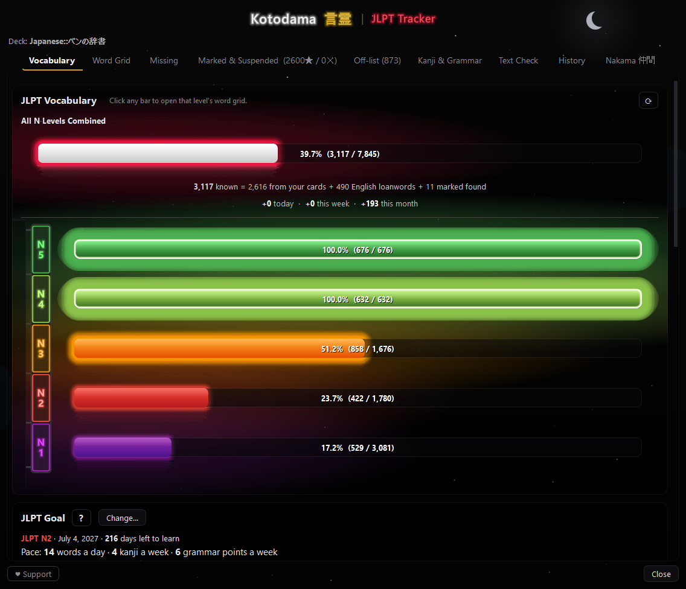
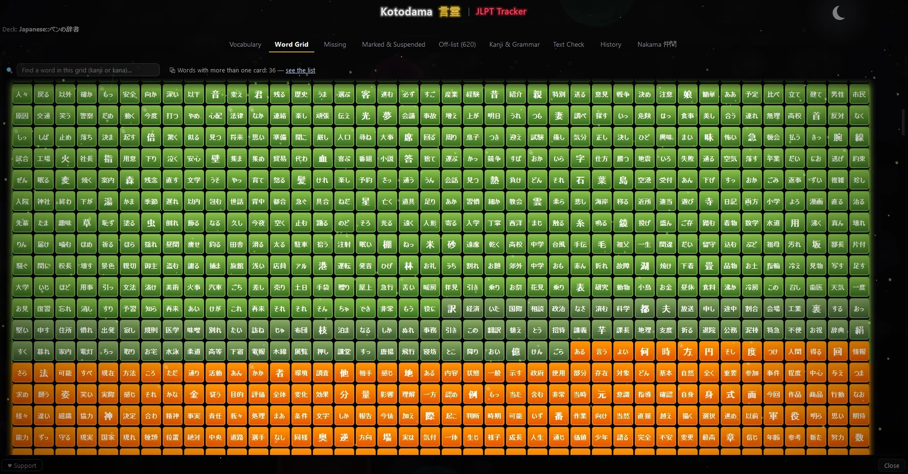
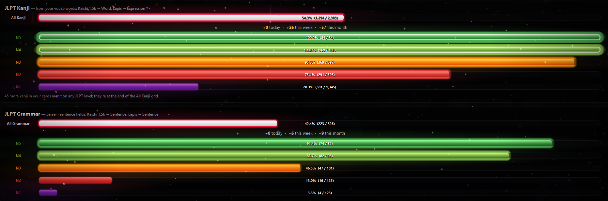
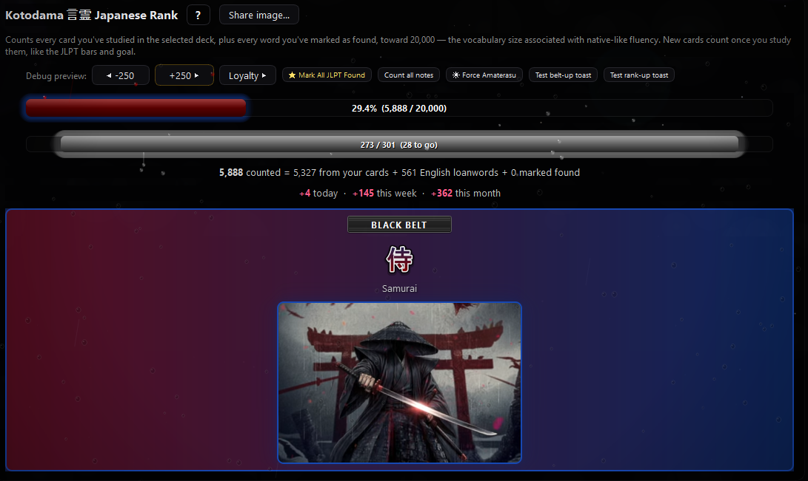
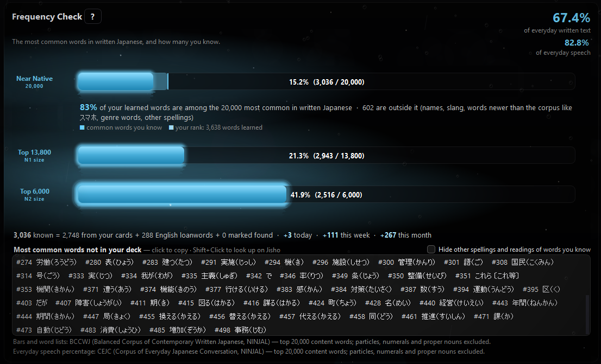
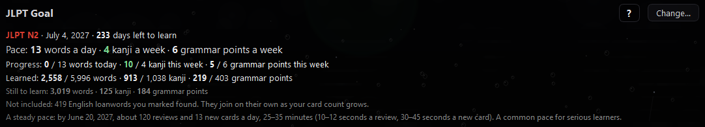
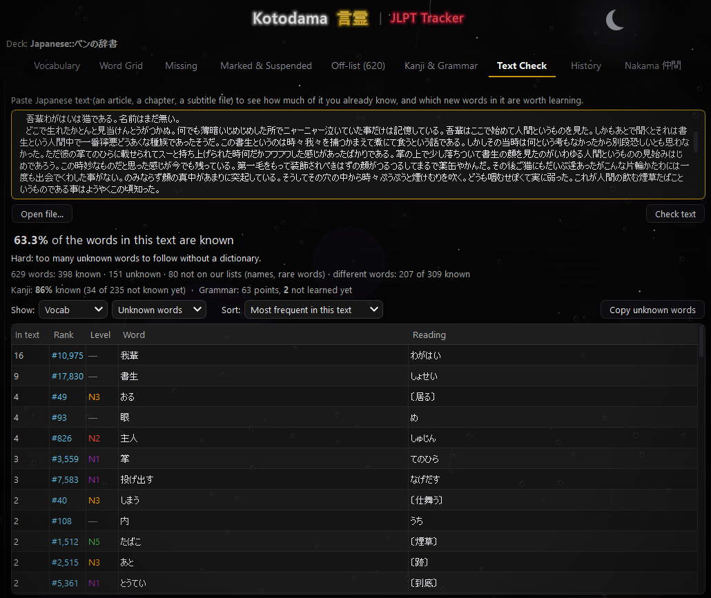
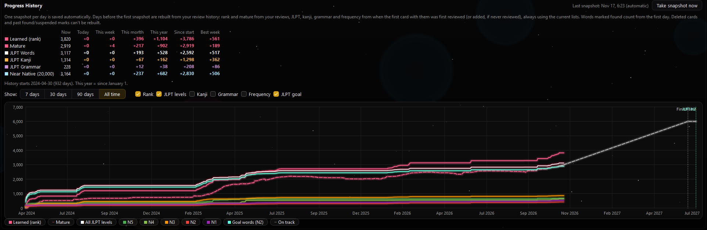
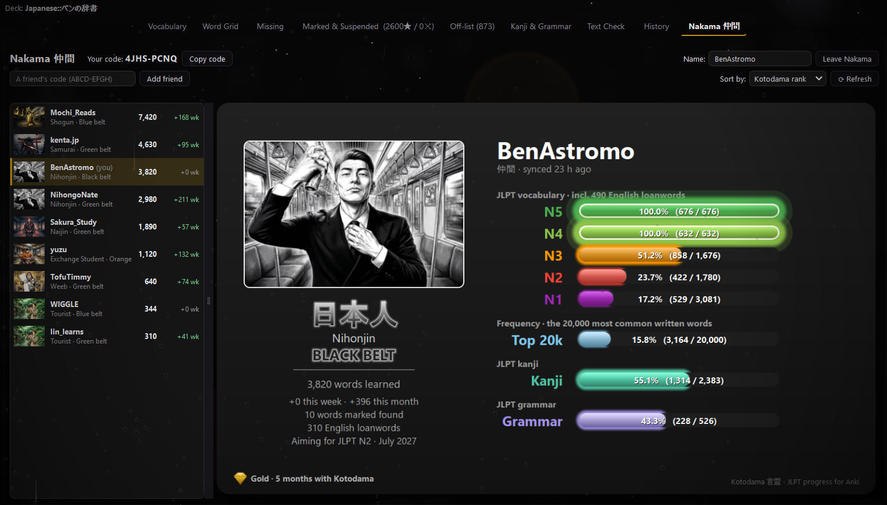
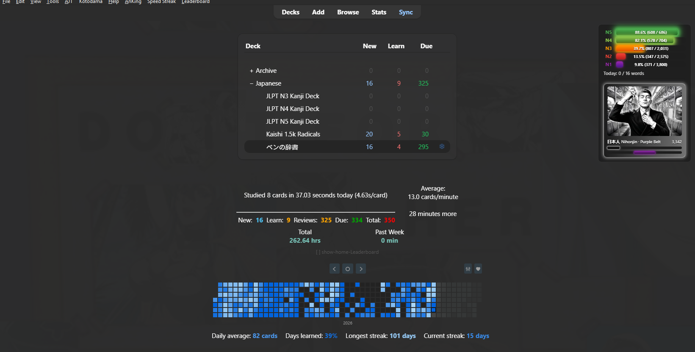

# Kotodama 言霊: release drafts (2026-10-17)

Drafts for the owner to edit and paste. Nothing in the add-on reads this file, and `tools/build_package.py` leaves it out of the package (it isn't on the allow-list: that's fine, but it will be reported as an unknown file; delete it or add it to the skip list once used).

---

## Owner decisions (answer these first)

**Answered 2026-10-20 (owner):**

1. **Licence for our own code**: **AGPL-3.0-or-later.** LICENSE = the official text from gnu.org (verbatim); copyright line in the README.
2. **Author name**: **BenAstromo** (manifest, README copyright line, AnkiWeb page).
3. **Ko-fi link**: **https://ko-fi.com/benastromo** (♥ Support button built; §6 filled in).
4. **Bug-report place**: a GitHub page, later (§6 placeholder stays until then).
5. **Rank picture credit**: **no Grok credit** (owner). The README / AnkiWeb lines now credit the pictures to the author. Note kept for the record: xAI's terms were read earlier as expecting attribution; the owner decided against it. Still check that the Wallpaper Engine scene uses only your own assets.
6. **Rank name "Gaijin" (外人)**: **kept.**
7. **Accuracy numbers on the page**: **not published** (owner); kept documented at the end of §6.
8. **Screenshots / GIF** for the page: Overview, Kanji & Grammar grid, Text Check, Missing → Grammar, the mini widget, the share image.

---

## 1. Grok prompts for the three rank pictures to regenerate (to-do 0b)

The current Shogun, Nihonjin and Naijin pictures copy real people's photos (an actor's costume photo, an advert, a private person's meme photo). Make new ones from text alone, with **invented faces** and a **different pose**. Match the existing set: 3:2 landscape (the art is shown at 480×320), the figure centred from the knees or waist up, dramatic light, a detailed Japanese setting behind. Generate several, pick one, and don't feed any old picture back in as a reference.

### Shogun (将軍): replaces the golden samurai
> Cinematic digital painting, 3:2 landscape, near-monochrome gold-on-black colour grade. A middle-aged Japanese warlord stands squarely facing the viewer, centred in a vast dark castle hall, framed from the knees up. His armour is lacquered in deep gold with fine black lacing, broad layered shoulder guards and a plain gold breastplate. His helmet has a low, wide golden crest shaped like a stylised sunburst or deer antlers, not a tall crescent. Both hands rest together on the pommel of a long sheathed katana planted upright in front of him, its tip on the floor. His face is entirely invented, not resembling any real person or actor: lean, clean-shaven or with a thin moustache, eyes looking slightly past the viewer with quiet authority. Tall gold-on-black banners hang symmetrically on both sides between dark wooden pillars, decorated with swirling gold wave patterns and a simple abstract crest (a circle of leaves), no readable text or kanji. Thin wisps of pale smoke curl up beside him. Strong golden rim lighting outlines the armour against deep black shadows, gold highlights glint across the floor grid that leads into the darkness, and a few paper lanterns glow faintly in the distance. Highly detailed, painterly, dramatic, no text, no watermark.

Avoid: the old picture's three-quarter turn with the head tilted, the diagonal sword held low across the body, the tall crescent helmet crest with a round medallion, the studded shoulder plates, the brocade chest panel, a greying beard, and the 秀神 banners. Keep the gold-on-black grade, rim light, symmetrical banners, smoke and hall: those came from the owner's own edit.

### Nihonjin (日本人): replaces the businessman spraying his hair on a train (DONE 2026-10-30: owner's new picture is in)
> Black-and-white ink illustration in the style of a detailed manga panel, 3:2 landscape. A tired but kind Japanese office worker in his thirties stands holding a hanging strap on a crowded morning commuter train. He wears a dark suit and a loosened tie, and a convenience-store coffee is in his other hand. Invented face with short neat hair, not resembling any real person. Through the windows, the city rushes past in motion blur, and soft morning light falls through the train. Fine cross-hatching, high contrast, no text, no logos, no adverts on the train walls.

Avoid: hairspray, both hands raised to the head, and any product. The new pose should read as an ordinary daily routine, not an advert.

### Naijin (内人): replaces the man in the dark kimono with steepled hands (NOT DOING: owner 2026-10-30 keeps the current picture)
> Warm digital illustration, 3:2 landscape. A friendly Western man in his late twenties with an invented face, not resembling any real person, sits relaxed on the engawa (wooden veranda) of a traditional Japanese house in the evening. He wears a simple indigo yukata with a subtle white pattern, holds a cup of green tea and smiles as he talks with an elderly Japanese neighbour, who is partly visible at the edge of the frame. Behind them are paper shoji screens glowing with lamplight, a small garden with a stone lantern, and a sunset sky. The mood is that he belongs here, at home in the community. Soft painterly lighting, no text.

Avoid: standing front-on with steepled hands, the red-polka-dot robe, a tatami room with tables, and anything that echoes the "weeb" meme. The rank means "an integrated foreigner", so show belonging, not costume.

---

## 2. Licence options for our own code (to-do 0c)

This covers only the code we wrote. Bundled data keeps its own licence whatever we choose (see §3), so the README should say both.

| Option | For | Against |
|---|---|---|
| **AGPL-3.0-or-later** (recommended) | Same licence as Anki itself. Add-ons import Anki's code (`aqt`), and AGPL is the safe reading of that. Forks must stay open. | Stricter than most users care about. Companies avoid AGPL code (irrelevant here). |
| GPL-3.0-or-later | Copyleft, widely understood, and compatible with AGPL. | Arguably weaker than Anki's own terms for a plugin that imports it. |
| MIT | Short and permissive, and very common for add-ons. | Anyone can take the code into a closed or paid product. And since the add-on imports AGPL code, the combined work is AGPL anyway, so MIT mostly signals intent. |

**Data licence facts the README must state (whatever the code licence):**
- JMdict / KANJIDIC2 / Jitendex / OpenJLPT: **CC BY-SA 4.0**. Attribution is required, and our derived data files (meanings.json, jlpt_n*.txt, kanji_jlpt.txt, grammar_jlpt.json, kinds_fix.txt, kana_ok.txt) must stay CC BY-SA 4.0.
- Jonathan Waller's JLPT levels: **CC BY**.
- BCCWJ frequency lists (NINJAL): **CC BY-NC-ND 3.0**. **Non-commercial**: a free add-on with a voluntary tip is the most compatible form, and nothing may ever be unlocked by paying until NINJAL agrees. **No derivatives**: our trimmed / split files (freq_bccwj.txt, freq_extra.txt, freq_splits.py) are technically derivatives. The owner accepted this risk earlier; asking NINJAL is the clean fix.
- Tatoeba: **CC BY 2.0 FR**. No Tatoeba sentences ship. kana_usual.txt is a word list chosen by counting Tatoeba spellings (facts, not text), so credit is courtesy rather than a requirement.

**Not legal advice.** For a free add-on, AGPL code plus clearly labelled data licences is the standard, low-risk setup.

**LICENSE file:** put the full AGPL-3.0 text in `LICENSE` (build_package.py already warns that it's missing). Add a short `NOTICE` or "Data licences" section to the README pointing to each source.

---

## 3. README credits (replacement for "Data sources & credits")

Every source below was checked against the code and bundled files (2026-10-17).

```markdown
## Data sources & credits
- **JLPT vocabulary lists:** [OpenJLPT](https://github.com/evanclan/OpenJLPT) (CC BY-SA 4.0), levels from [Jonathan Waller's JLPT lists](https://www.tanos.co.uk/jlpt/) (CC BY). A few Waller words OpenJLPT omits come via [stephenmk/yomitan-jlpt-vocab](https://github.com/stephenmk/yomitan-jlpt-vocab). 211 community additions come from [jamsinclair/open-anki-jlpt-decks](https://github.com/jamsinclair/open-anki-jlpt-decks) and [elzup/jlpt-word-list](https://github.com/elzup/jlpt-word-list), flagged `community` in the list files.
- **Grammar points** (patterns, meanings, formation, examples): [OpenJLPT](https://github.com/evanclan/OpenJLPT) contributors (CC BY-SA 4.0)
- **Kanji levels, readings and meanings:** [OpenJLPT](https://github.com/evanclan/OpenJLPT) (CC BY-SA 4.0): Jonathan Waller's kanji levels (CC BY) and [KANJIDIC2](https://www.edrdg.org/wiki/KANJIDIC_Project.html), EDRDG (CC BY-SA 4.0)
- **Dictionary data** (word kinds for the parser, loanword flags, spelling mapping): [JMdict](https://www.edrdg.org/jmdict/j_jmdict.html), Electronic Dictionary Research and Development Group (CC BY-SA 4.0)
- **Meanings on hover:** [Jitendex](https://jitendex.org) by Stephen Kraus (CC BY-SA 4.0), based on JMdict
- **Frequency list and rank:** BCCWJ short-unit-word frequency list v1.0, National Institute for Japanese Language and Linguistics (NINJAL) (CC BY-NC-ND 3.0). **Estimated ranks for compounds (≈):** BCCWJ long-unit-word frequency list v1.0, NINJAL (CC BY-NC-ND 3.0).
- **Usually-kana word list and accuracy testing:** sentences from [Tatoeba](https://tatoeba.org) (CC BY 2.0 FR) were used to measure the parser and to find words usually written in kana. No Tatoeba sentences are included.
- **Star sounds:** synthesised by the author from the Sun's measured oscillation spectrum (helioseismology), sped up into hearing range.

Derived data files (jlpt_n*.txt, kanji_jlpt.txt, grammar_jlpt.json, meanings.json, kinds_fix.txt, kana_ok.txt, kana_usual.txt) are shared under CC BY-SA 4.0. The frequency files (freq_bccwj.txt, freq_extra.txt, freq_splits.py) remain under NINJAL's CC BY-NC-ND 3.0 terms. The add-on's code is licensed under the GNU Affero General Public License v3.0 or later (AGPL-3.0-or-later), see LICENSE.

Kotodama is not affiliated with or endorsed by the Japan Foundation, JEES (the JLPT's organisers), NINJAL, the EDRDG, Tatoeba, or Ankitects (Anki). "JLPT" refers to the Japanese-Language Proficiency Test; there is no official JLPT vocabulary or grammar list, and these are community lists.
```

Checked and **not needed**: no bundled fonts (system fonts only), no third-party sounds (the chime WAV is generated at run time, the star sounds by `tools/star_ambience.js`), and no third-party Python packages. MeCab / UniDic were used only in dev tools that don't ship.

---

## 4. New `manifest.json` description

The current one says "Vocabulary Rank" (outdated).

```
JLPT N5–N1 progress for your Anki deck: vocabulary, kanji and grammar coverage, a 20,000-word frequency rank, a Text Check for any Japanese text, and a share image. Free, offline.
```

(178 characters. The `name` "Kotodama — JLPT Progress & Rank Tracker" is fine. Fill `author` (decision 2), and bump `version` together with `__init__.py` and README, e.g. to 3.0.0 since so much changed.)

---

## 5. Not-affiliated line and privacy line

**Not affiliated (short form, for the page footer and the "?" popup):**
> Kotodama is an independent fan project, not affiliated with the Japan Foundation, JEES or Anki. There is no official JLPT word or grammar list: the levels come from community lists (OpenJLPT / Jonathan Waller).

**Privacy (rewritten 2026-10-17 for Nakama):**
> Kotodama works offline. It connects to the internet only if you join **Nakama** (the friends tab): then your chosen name and the numbers on your bars (rank, JLPT words per level, top-20k words, kanji, grammar, this week's gain) are sent to Kotodama's small server after Anki syncs, and your friends' cards are fetched when you open the tab. No cards, words, sentences or deck names are ever sent. Anyone you give your friend code to can see your card; there is no search or public list. Leaving Nakama deletes your card from the server. Everything else stays in the add-on's folder on your computer (`addons21/jlpt_progress/user_files/`). Shift+click on a word (or the search buttons) opens Jisho or a Google search in your web browser, only when you click.

What `user_files/` holds, for reference: `history.json` (daily progress snapshots), `overrides.json` / `kanji_overrides.json` / `grammar_overrides.json` (found and suspended marks), `found_count.json`, `parse_cache.json` / `words_cache.json` (parser caches), `nakama.json` (your Nakama code, secret key, friends' codes and their cached cards, your last snapshot), and `ascension_chime.wav` (generated). Settings live in Anki's own add-on config (`meta.json`). Network code: only `nakama.py` (urllib, HTTPS to `kotodama-nakama.kotodama-anki.workers.dev`, only after Join); the server's code is `server/worker.js` (Cloudflare Worker + D1, free plan). Web links otherwise: jisho.org and google.com searches opened by `QDesktopServices.openUrl` on a click.

---

## 6. AnkiWeb page draft (rewritten 2026-11-01 from the new README)

Same text as the README, shortened to what AnkiWeb allows (`<b>`, `<i>`, `<a>`, ``, line breaks). The images load from the GitHub repo, so they only show once the repo is **public**. Swap `rank.png`, `nakama.png` and `main-screen.png` for the GIFs when they exist, and fill in the AnkiWeb code in the README after uploading.

```html
<b>Kotodama 言霊: see how much Japanese your Anki deck really covers.</b>

Kotodama reads the deck you already have and shows your progress through every JLPT level, N5 to N1, in <b>vocabulary, kanji and grammar</b>. It finds the grammar in your cards' example sentences, so mined sentence cards count too. You don't need a separate grammar deck. Free, offline.



<b>JLPT vocabulary, N5 → N1</b>
One bar per level, about 9,800 words. Click a bar for a grid of every word: known words lit up, missing ones dark. Hover for the meaning, click to copy, Shift+click for Jisho.



<b>Kanji and grammar, from your own cards</b>
All 2,383 JLPT kanji, coloured by how well you know each one. A built-in parser finds the 526 JLPT grammar points in your example sentences, conjugated forms included. Anything it misses can be marked found in one click.



<b>Kotodama Japanese Rank</b>
Every card you've studied counts toward 20,000 words, the vocabulary of native-like fluency. Ten ranks from Gaijin (外人) up, eight belts each. The top rank stays secret until you reach it.



<b>Frequency Check</b>
Compares your deck with the 20,000 most common words of written Japanese: what share of everyday text and speech you can follow, and the most common words you're missing.



<b>JLPT Goal</b>
Pick your level and test date, and Kotodama works out how much to learn each day to be ready two weeks early. No streaks, nothing lost for a missed day.



<b>Text Check</b>
Paste any Japanese text or open subtitles: see what share of its words you know, its kanji and grammar, and which words to learn first.



<b>History</b>
Your progress over time, rebuilt from your review history.



<b>Nakama 仲間</b>
Swap friend codes and see your friends' bars next to yours. Friends only: no search, no public list. Optional.



<b>Main screen widget and share image</b>
Your bars, today's goal and your rank next to the deck list, and a picture of your progress to post.



<b>Setup</b>
Kotodama menu → Settings: pick your deck and the field with the Japanese word (optionally the reading and example sentence). That's it.

<b>Privacy</b>
Works offline. Only if you join Nakama are your name and bar numbers sent (never your cards, words or deck names), and only friends with your code can see them. Leaving removes them from the server.

<b>Free</b>
Kotodama is free, and nothing is unlocked by money. If it helps you: <a href="https://ko-fi.com/benastromo">♥ Support on Ko-fi</a>.

Bugs, ideas and the full guide: <a href="https://github.com/BenAstromo/kotodama">GitHub</a>

<i>Requires Anki 2.1.50 or newer (desktop). An independent fan project, not affiliated with the Japan Foundation, JEES or Anki; there is no official JLPT list, the levels come from community lists. Data: OpenJLPT, Jonathan Waller's JLPT lists, JMdict / KANJIDIC2 (EDRDG), Jitendex, BCCWJ and CEJC (NINJAL). Full credits and licences on GitHub.</i>
```

Measured accuracy: documented here only, NOT published on the page (owner 2026-10-20). If it's ever quoted, use only fresh measurements, never tuned ones:
- Grammar precision: 99% (95% CI 96–100%), from 200 detections drawn as they occur in real text (fresh precision sample 8, 2026-10-20, after the 2026-10-20 rounds). Per level: N3 96%, N2 96%, N1 100% (37/37). Earlier (sample 7): 98%.
- Grammar recall: 90.5% (87–93%), fresh recall sample 12 (2026-10-20, 100 sentences annotated blind). Earlier (sample 11): 92% (88–94%) — the same within the margin. Round to "about 90%".
- Words: fresh vocab set 2 before its fixes gave recall 97.8% and precision 97.8%. All 250 sentences now (tuned) give 99.4% / 99.3%; don't quote those.

---

## 7. Licence audit (research 2026-10-28; not legal advice)

Each source's own terms page was read on 2026-10-28 unless noted.

| Source (what we ship) | Licence found | Status | To do |
|---|---|---|---|
| OpenJLPT (jlpt_n*.txt, kanji_jlpt.txt, grammar_jlpt.json) | CC BY-SA 4.0 (repo LICENSE; per-field NOTICE.md) | OK | Keep credit; derived files stay CC BY-SA 4.0 (README says so). |
| JMdict + KANJIDIC2, EDRDG (spellings, loanword flags, kana lists) | CC BY-SA 4.0. Commercial use allowed. **Apps must acknowledge on a separate screen reachable from a menu (e.g. "About"); a start-up page or docs alone isn't enough.** Ship or link the licence; update regularly. | **Gap** | Add an in-app Credits / About screen (menu: Kotodama → About) naming JMdict/EDRDG with links. Rebuild from current JMdict before release (done 2026-10-28 for the lists). |
| Jitendex, Stephen Kraus (meanings.json) | CC BY-SA 4.0 (jitendex.org) | OK | Also name it on the Credits screen. |
| Jonathan Waller's levels (via OpenJLPT, yomitan-jlpt-vocab) | CC BY (stated by yomitan-jlpt-vocab's README and others; tanos.co.uk itself no longer resolves) | OK, link dead | Point the README link at an archive.org copy of tanos.co.uk/jlpt/. |
| stephenmk/yomitan-jlpt-vocab (extra Waller words) | CC BY-SA 4.0 | Credit OK | Say "CC BY-SA 4.0" in the README line. |
| jamsinclair/open-anki-jlpt-decks, elzup/jlpt-word-list (211 community words) | **MIT** | Small gap | MIT asks to keep the copyright + permission notice with "substantial portions": add both notices to a THIRD_PARTY_NOTICES file (cheap, removes doubt). |
| BCCWJ SUW/LUW lists, NINJAL (freq_bccwj.txt, freq_extra.txt, freq_splits.py) | Website: "free for research and education" (no licence named); our 2026-10-08 download record: CC BY-NC-ND 3.0 (repository record 3234; down today, not re-read) | **Open (NC + ND)** | Ask NINJAL (email below). |
| CEJC vocabulary table, NINJAL (freq_cejc.txt) | Download page: CC BY-NC-ND 3.0 icon. Guideline: corpus data (audio, transcripts, annotations) may not be redistributed; vocab tables not addressed; publications must say they use CEJC and cite its papers. | **Open (NC + ND)**, low risk (a word list can't rebuild conversations) | Same email; add the CEJC citation to the README credits. |
| Tatoeba (tools/ only: grammar_examples.json, accuracy samples) | CC BY 2.0 FR (well known; terms page timed out today) | Not shipped in the add-on | If the GitHub repo goes public, add a Tatoeba credit line for tools/. |
| Rank pictures (Grok) | xAI consumer terms: user owns outputs, commercial use allowed; **brand guidelines ask for a "Created with Grok" credit** where published | **Conflicts with "no Grok credit"** | Owner's call: add "Rank art created with Grok" to the README / Credits screen, or redraw. Three pictures still copy real people's photos (§1): regenerate before release. |
| Amaterasu animation (Wallpaper Engine, owner's own scene) | Owner's project; check that no Workshop assets by others are inside | Probably OK | Owner confirms. |
| Star sounds (media/star_*.ogg) | Generated by our own tools/star_ambience.js | OK | — |
| Our code | AGPL-3.0-or-later (LICENSE present) | OK | — |
| AnkiWeb rules on donation links | No published rule found; many add-ons link Ko-fi / Patreon | Probably OK | Keep the link on the page and in the add-on's ♥ Support; no popups. |

**The main question, NC vs donations.** Creative Commons defines NonCommercial as "not primarily intended for or directed towards commercial advantage or monetary compensation", judged by the purpose of the use, and leaves donations to the licensor. A free add-on with a voluntary tip is the most compatible form; the "♥ Supported Kotodama" line (recognition, unlocks nothing) is a grey area. Only NINJAL can settle NC and ND for good.

### Email to NINJAL (owner sends; contact via the BCCWJ / CEJC pages' contact links)

> Subject: Permission request: BCCWJ and CEJC frequency lists in a free Anki add-on
>
> Dear NINJAL Center for Language Resource Development,
>
> I am the developer of Kotodama, a free, open-source add-on (AGPL-3.0) for the flashcard program Anki that shows Japanese learners how their vocabulary compares with real Japanese. I would like to confirm that my use of two of your frequency lists is acceptable, or ask for permission if it is not.
>
> 1. BCCWJ short-unit and long-unit word frequency lists (Version 1.0): the add-on bundles the 20,000 most common content words (particles, numerals and proper nouns removed, spellings matched to the JMdict dictionary) to show learners how many common words they know.
> 2. CEJC short-unit vocabulary table (ver202209): the add-on bundles the 20,000 most common content words to show one percentage, "of everyday speech". No transcripts, audio or other corpus data are included.
>
> Both lists are credited to NINJAL with their licence (CC BY-NC-ND 3.0) in the documentation. My questions:
>
> a) Because the files are filtered and re-mapped, they may count as derivatives under "NoDerivatives". May I distribute them in this form?
> b) The add-on is free and nothing is sold. Users may send a voluntary tip through Ko-fi, and supporters see a small thank-you line that unlocks nothing. Is this compatible with "NonCommercial"?
> c) Is there a citation or acknowledgement wording you would like me to use?
>
> Thank you for making these resources available.
>
> BenAstromo (Kotodama developer)

**Done 2026-10-28:** Kotodama → About Kotodama… (`about.py`, credits + JMdict's acknowledgement wording, links); `THIRD_PARTY_NOTICES.txt` (both MIT notices, ships with the add-on); README: Waller link → archive.org copy (20260406082505), yomitan-jlpt-vocab licence, MIT note, pointer to the About screen. Step 3 done (BCCWJ + CEJC citations in README and About). Still open: step 5 (regenerate the three rank pictures). Owner 2026-10-28: step 1 dropped (no NINJAL email, accepted risk); no Grok credit.

### Order of work
1. Send the NINJAL email (owner). 2. Credits / About screen in the add-on (JMdict's requirement; also Jitendex, OpenJLPT, NINJAL, Waller, MIT notices). 3. README: CEJC citation, archive link for Waller, licence names for the community lists, Grok decision. 4. THIRD_PARTY_NOTICES with the two MIT notices. 5. Grok credit or redraw; regenerate the three rank pictures.
